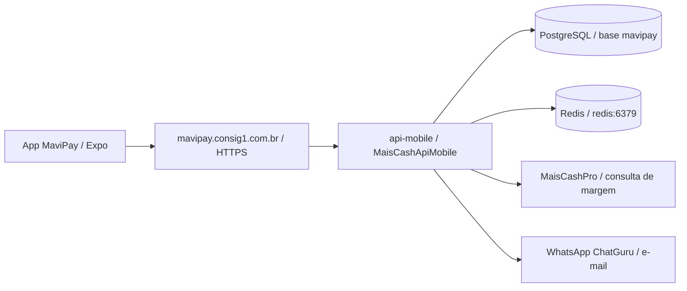

# Arquitetura do workspace

O workspace organiza os projetos MaisCashTech como submódulos Git. O código e os
pipelines pertencem aos repositórios de cada serviço; o monorepo registra os
commits utilizados e reúne as orientações de integração.

| Diretório | Responsabilidade |
|---|---|
| `services/` | Backends, incluindo MaisCashPro, serviços Consig1 e MaviPay |
| `frontend/` | Aplicações web |
| `common/` | Bibliotecas e integrações compartilhadas |
| `infra/` | Infraestrutura e seus pipelines, incluindo Redis |
| `legacy/` | Projetos legados |

## MaviPay

O repositório [MaisCashTech/mavipay](https://github.com/MaisCashTech/mavipay), em
`services/mavipay`, contém `api-mobile/` (backend Spring Boot, Java 21) e
`maiscash-app/` (aplicativo Expo). O Jenkinsfile da raiz compila e implanta somente
o backend; a publicação do aplicativo móvel utiliza EAS e é um processo separado.

O backend está implantado em `mavipay.consig1.com.br`, com health check 200/UP,
PostgreSQL e Redis acessíveis. ChatGuru está configurado, mas o envio real e os
fluxos de negócio ainda precisam ser testados com destinatário autorizado. SMTP
permanece sem credenciais, afetando somente o canal alternativo por e-mail.

| Componente | Integração em produção |
|---|---|
| API | Container `MaisCashApiMobile`, rede Docker `consig1`; bind `127.0.0.1:7920` → `8080` |
| PostgreSQL | Servidor existente no `mct-main`, base exclusiva `mavipay`, role `mavipay_app`; gateway da rede `consig1` em `172.19.0.1:5432` |
| Redis | Container `redis`, rede `consig1`, porta interna `6379`, sem publicação no host |
| MaisCashPro | `CONSIG_API_URL=http://maiscashpro-app-1:8080`, na mesma rede Docker |
| Mensagens | ChatGuru configurado; SMTP pendente para o canal alternativo por e-mail |

A base é criada administrativamente; as tabelas são gerenciadas pelas migrations
Flyway em `api-mobile/src/main/resources/db/migration/`. A versão inspecionada
contém V1–V20, aplicadas com sucesso no primeiro deploy pelo Flyway no PostgreSQL
13.23. O histórico registra 20 migrations bem-sucedidas.

## Papel do Redis

Redis é dependência funcional do MaviPay: armazena cadastros pendentes, desafios de
códigos de acesso, contadores de tentativas/consultas e cache de bancos/taxas.
Cadastro e autenticação dependem dele; desabilitar apenas o cache não remove a
necessidade do serviço. Os serviços anteriores não foram alterados para usar Redis.

O repositório [MaisCashTech/redis](https://github.com/MaisCashTech/redis) contém
somente `README.md` e `Jenkinsfile`. Seu pipeline instala a imagem oficial Redis
7.4.12 fixada por digest, com autenticação obrigatória, AOF e volume persistente
`maiscash_redis_data`. A rede é interna, sem proxy NGINX ou porta pública.

O Redis utiliza limite de 256 MiB para dados e política `noeviction`; o container
tem limite de 512 MiB e 1 CPU. Ao atingir o limite de dados, escritas podem falhar;
monitorar capacidade também faz parte da operação. Não há alta disponibilidade
ou backup externo agendado nesta implantação.

## CI/CD e segredos

Os jobs usam o agente `built-in` do Jenkins MaisCashTech e o Docker do `mct-main`.
Java 21 é utilizado dentro do Docker de build do MaviPay, sem alterar o JDK dos
demais serviços. Builds do Redis e do MaviPay são serializados por job.

A instalação do Redis e o deploy do MaviPay são jobs independentes. O primeiro
valida autenticação, TTL, GETDEL e persistência; o segundo utiliza health check e
rollback do container. O volume de dados Redis é preservado nas reinstalações.

Os segredos ficam no Jenkins, fora dos repositórios. Consulte os detalhes em
[operação MaviPay e Redis](mavipay-redis-operations.md) e o procedimento local em
[setup de desenvolvimento](development-setup.md).
